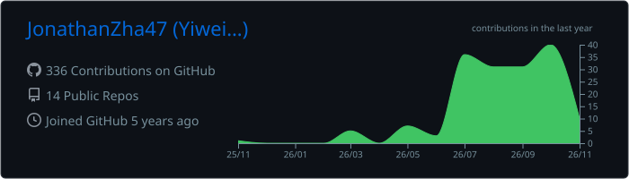
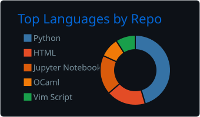
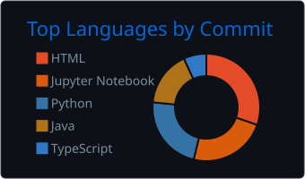
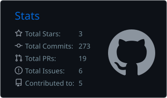
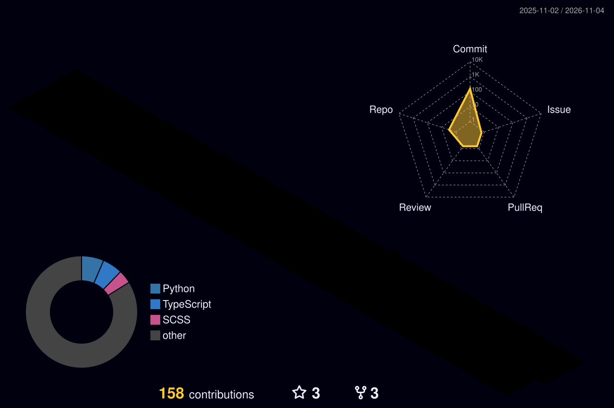

## About Me

I am a first-year PhD student at **[VUSec](https://www.vusec.net/), Vrije Universiteit Amsterdam**, supervised by **Min Chen** and **Herbert Bos**.

I work on the safety of **AI agents**: language models that no longer only answer but act, editing files, running commands, and operating browsers and phones. I look for **new attack surfaces where agents are actually deployed**: the context, memory, and harness around the model, tool and multi-agent handoffs, and the screens that GUI agents read. Finding an attack or proposing a defense is not enough. I also want to understand *why* the failure happens, using **mechanistic interpretability** to trace how an agent breaks a rule and to build monitors that catch it before it acts.

<table>
  <tr>
    <td width="50%">
      <h3>Current Research</h3>
      <ul>
        <li><b>ARCBench</b>: do agents still follow their rules after context compaction?</li>
        <li><b>PIIBench</b>: can defensive prompt injection protect PII from LLM agents?</li>
        <li><b>SEAL</b>: shared-expert alignment for Mixture-of-Experts safety (CCS 2026)</li>
        <li>Mechanistic interpretability for agent rule-violation monitors</li>
      </ul>
    </td>
    <td width="50%">
      <h3>Open To</h3>
      <ul>
        <li>Collaborations on AI agent safety and security</li>
        <li>Agent harness, memory, and GUI-agent attack surfaces</li>
        <li>Agent benchmarks and evaluation design</li>
        <li>Interpretability-driven monitors and defenses</li>
      </ul>
    </td>
  </tr>
</table>

## Toolbox

## GitHub Activity

## Selected Publications

- **SEAL: Reinforcing Global Safety in Mixture-of-Experts through Shared Expert ALignment**. Meng, Q., **Zha, Y.**, et al. *ACM CCS 2026*. [arXiv](https://arxiv.org/abs/2609.02293)
- **PADBen: A Comprehensive Benchmark for Evaluating AI Text Detectors Against Paraphrase Attacks**. **Zha, Y.**, Min, R., Sushmita, S. *ICANN 2026*. [arXiv](https://arxiv.org/abs/2511.00416) · [Code](https://github.com/JonathanZha47/PadBen-Paraphrase-Attack-Benchmark)
- **iTransPASOH: A Physics-Aware iTransformer Framework for Lithium-Ion Battery State-of-Health Estimation**. **Zha, Y.**, Yan, F., Yang, C., Mao, G. *Knowledge-Based Systems, 2026*. [DOI](https://doi.org/10.1016/j.knosys.2026.115785)
- **Target-Driven Dynamic Weighted Joint Distribution Adaptation Network for Soft Sensing of Tumbler Strength in Sintering Process**. Yan, F., **Zha, Y.**, et al. *IEEE/ASME Transactions on Mechatronics, 2026*. [DOI](https://doi.org/10.1109/TMECH.2025.3647671)
- **MobileAgentBench: An Efficient and User-Friendly Benchmark for Mobile LLM Agents**. Wang, L., Deng, Y., **Zha, Y.**, et al. *AAAI 2025 MARW Workshop*. [arXiv](https://arxiv.org/abs/2406.08184)

**Under review & preprints**

- **Do Agents Still Follow the Rules? Benchmarking Rule Compliance under Agent Context Compaction (ARCBench)**. **Zha, Y.**, Meng, Q., Bos, H., Chen, M. *Under review at ACL 2027*. [arXiv](https://arxiv.org/abs/2611.03223) · [Code](https://github.com/VUAISec/ARCBench)
- **PIIBench: Can Personally Identifiable Information Really Be Protected? Evaluating Defensive Prompt Injection against Agent Extraction**. Liu, M.\*, **Zha, Y.**\*, Chen, M. (\*equal contribution). *Under review at WWW 2027*.

## Connect

I am happy to talk about AI agent safety, agent attack surfaces, benchmarks, and mechanistic interpretability.

